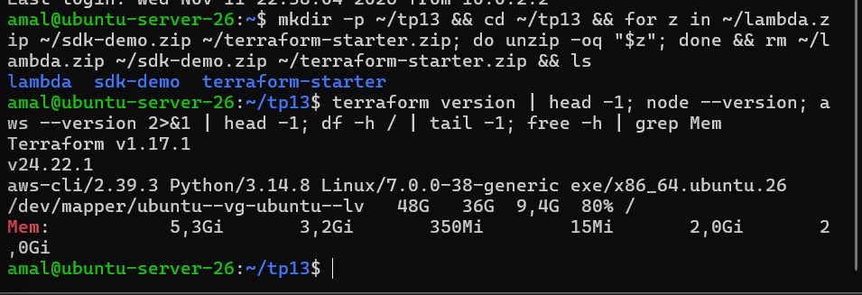
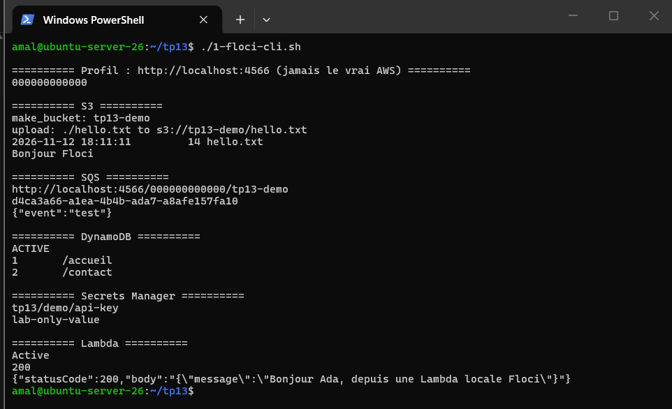
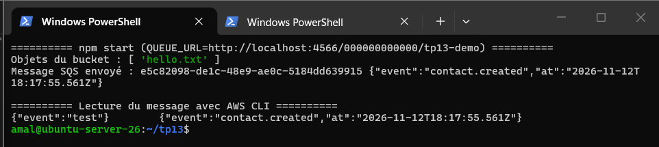
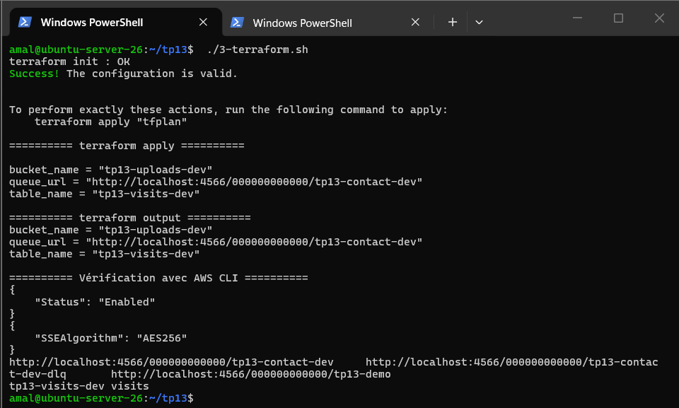
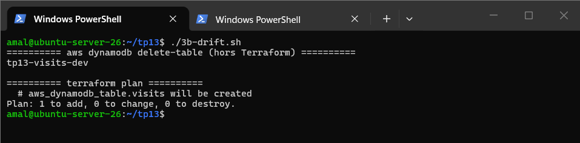
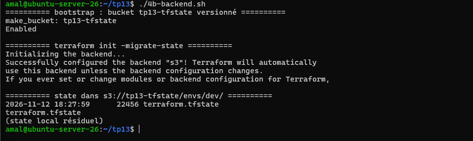
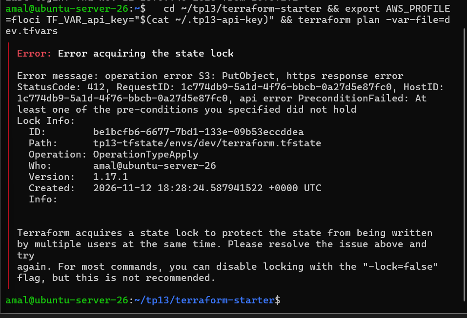
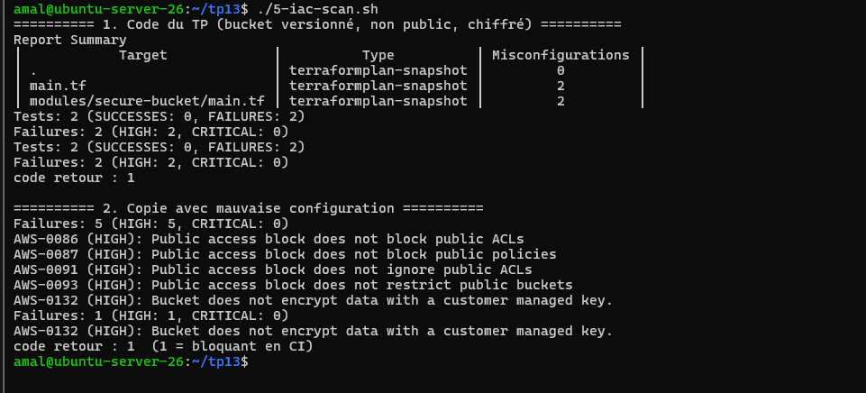
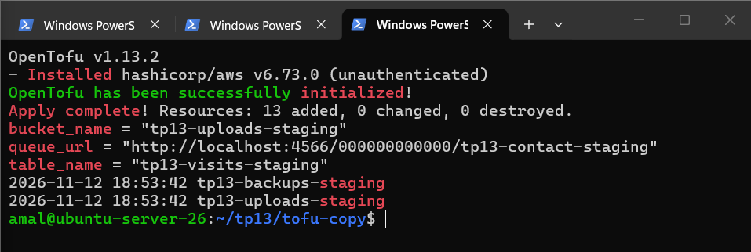

# TP13 – Cloud local avec Floci et Terraform

> **Cours** : DevOps & Cloud (Teknolabs), Partie 5 : Cloud & Kubernetes
> **Étudiante** : Amal Jemli, Master DevOps
> **Objectif** : manipuler les services AWS (S3, SQS, DynamoDB, Secrets Manager, Lambda) **sans compte AWS ni carte bancaire** grâce à l'émulateur local **Floci**, puis décrire cette infrastructure en **Infrastructure as Code** avec Terraform : modules, state distant verrouillé, environnements, scan de sécurité IaC et compatibilité OpenTofu.

---

## Sommaire

1. [Environnement](#1-environnement)
2. [Partie 1 : Floci et AWS CLI](#2-partie-1--floci-et-aws-cli)
3. [Partie 2 : SDK JavaScript v3](#3-partie-2--sdk-javascript-v3)
4. [Partie 3 : Terraform et détection de dérive](#4-partie-3--terraform-et-détection-de-dérive)
5. [Partie 4 : Module, state distant, verrou et environnements](#5-partie-4--module-state-distant-verrou-et-environnements)
6. [Partie 5 : Scan IaC (Trivy) et OpenTofu](#6-partie-5--scan-iac-trivy-et-opentofu)
7. [Comparaisons demandées](#7-comparaisons-demandées)
8. [Nettoyage](#8-nettoyage)
9. [Difficultés rencontrées](#9-difficultés-rencontrées)
10. [Sécurité](#10-sécurité)
11. [Livrables](#11-livrables)

---

## 1. Environnement

| Élément | Valeur |
|---|---|
| VM de lab | `amal@ubuntu-server-26` (Ubuntu, 5,3 Go RAM) |
| Émulateur AWS | **Floci** (`floci/floci`) sur `http://localhost:4566` |
| AWS CLI | 2.39.3 avec un profil dédié `floci` (identifiants factices `test`) |
| Terraform | 1.17.1, provider `hashicorp/aws ~> 6.0` |
| OpenTofu | 1.13.2 |
| Node.js | 24 (SDK AWS JavaScript v3) |
| Trivy | `aquasec/trivy:0.76.2` (en conteneur) |

Le script `scripts/0-setup.sh` installe les outils manquants, démarre Floci et crée le profil `floci` :

```bash
docker run -d --name floci -p 4566:4566 \
  -v /var/run/docker.sock:/var/run/docker.sock floci/floci
aws configure set aws_access_key_id test --profile floci
aws configure set aws_secret_access_key test --profile floci
aws configure set region us-east-1 --profile floci
aws configure set endpoint_url http://localhost:4566 --profile floci
```



> Le socket Docker est monté car Floci lance chaque fonction **Lambda** dans un conteneur. C'est acceptable sur une VM de lab jetable, mais à ne jamais faire sur une machine partagée : l'accès au socket équivaut à un accès root.

---

## 2. Partie 1 : Floci et AWS CLI

Script : `scripts/1-floci-cli.sh`. Toutes les commandes utilisent le profil `floci`, donc **aucune requête ne part vers le vrai AWS**.

| Service | Action réalisée |
|---|---|
| S3 | création du bucket, `cp` d'un fichier, `ls` |
| SQS | création de la file, envoi puis réception d'un message |
| DynamoDB | table `visits` (clé `id`), `put-item` puis `scan` |
| Secrets Manager | secret `tp13/demo/api-key`, lecture via `get-secret-value` |
| Lambda | déploiement de `lambda.zip` (fonction `hello`) et `invoke` |



---

## 3. Partie 2 : SDK JavaScript v3

L'application `sdk-demo` utilise le SDK AWS v3. Le **même code** fonctionnerait sur AWS ; seule la variable `AWS_ENDPOINT_URL` change.

Ajouts réalisés dans `index.js` :
- `CreateBucketCommand` au démarrage (idempotent, l'erreur « bucket existe déjà » est ignorée) ;
- envoi d'un message SQS `{ "event": "contact.created", "at": ... }` avec `SendMessageCommand` quand `QUEUE_URL` est défini.

Dans `compose.yaml`, l'application et Floci tournent ensemble. Le conteneur joint Floci par le **nom de service** (`http://floci:4566`), pas par `localhost`.

```yaml
services:
  floci:
    image: floci/floci
    ports: ["4566:4566"]
  sdk-demo:
    image: node:24-alpine
    environment:
      AWS_ENDPOINT_URL: http://floci:4566
      AWS_REGION: us-east-1
      AWS_ACCESS_KEY_ID: test
      AWS_SECRET_ACCESS_KEY: test
```



---

## 4. Partie 3 : Terraform et détection de dérive

### 4.1 Ressources décrites (`main.tf`)

| Ressource | Nom | Bonnes pratiques appliquées |
|---|---|---|
| `aws_s3_bucket` | `tp13-uploads-${env}` | versioning, **blocage d'accès public (4 options à `true`)**, chiffrement SSE AES256 |
| `aws_sqs_queue` | `tp13-contact-${env}` | **dead-letter queue** (`maxReceiveCount = 3`) |
| `aws_dynamodb_table` | `tp13-visits-${env}` | `PAY_PER_REQUEST`, clé `id` (S) |
| `aws_secretsmanager_secret` + `_version` | `tp13/${env}/api-key` | valeur issue de `var.api_key` marquée **`sensitive`** |

`variables.tf` valide l'environnement :

```hcl
variable "environment" {
  type = string
  validation {
    condition     = contains(["dev", "staging", "prod"], var.environment)
    error_message = "environment doit valoir dev, staging ou prod."
  }
}
variable "api_key" {
  type      = string
  sensitive = true
}
```

La valeur du secret n'est **jamais écrite dans le dépôt** : elle est générée une seule fois dans `~/.tp13-api-key` (droits `600`) puis passée via `TF_VAR_api_key`.



### 4.2 Dérive (drift)

Script : `scripts/3b-drift.sh`. Une modification est faite **à la main** avec la CLI (hors Terraform), puis `terraform plan` la détecte et propose de revenir à l'état déclaré. C'est la preuve que le code reste la **source de vérité**.



---

## 5. Partie 4 : Module, state distant, verrou et environnements

### 5.1 Module `secure-bucket` et blocs `moved`

Le bucket sécurisé (versioning, blocage public, chiffrement) est extrait dans `modules/secure-bucket` et réutilisé deux fois (`uploads` et `backups`). Les blocs `moved` indiquent à Terraform que les ressources ont **changé d'adresse** : il ne détruit pas le bucket existant pour le recréer.

```hcl
module "uploads" {
  source = "./modules/secure-bucket"
  name   = "tp13-uploads-${var.environment}"
}
module "backups" {
  source = "./modules/secure-bucket"
  name   = "tp13-backups-${var.environment}"
}

moved {
  from = aws_s3_bucket.uploads
  to   = module.uploads.aws_s3_bucket.this
}
# + 3 autres blocs moved (versioning, public access block, chiffrement)
```

### 5.2 State distant S3 avec verrou natif

```hcl
terraform {
  backend "s3" {
    bucket         = "tp13-tfstate"
    key            = "envs/dev/terraform.tfstate"
    region         = "us-east-1"
    use_lockfile   = true          # verrou natif S3, sans DynamoDB
    use_path_style = true
    endpoints      = { s3 = "http://localhost:4566" }
    skip_credentials_validation = true
    skip_requesting_account_id  = true
  }
}
```

Le bucket `tp13-tfstate` est **versionné**, ce qui permet de récupérer un state précédent en cas de corruption. La migration s'est faite avec `terraform init -migrate-state`.



### 5.3 Test du verrou ⭐

Deux `terraform apply` sont lancés en même temps dans deux terminaux. Le second échoue :

```
Error acquiring the state lock
StatusCode: 412 ... PreconditionFailed
Lock Info: Operation: OperationTypeApply  Who: amal@ubuntu-server-26
```

Le verrou empêche **deux personnes ou deux pipelines de corrompre le state** en l'écrivant en même temps.



### 5.4 Environnements

Un fichier `*.tfvars` par environnement (`dev`, `staging`, `prod`) et **une clé de state distincte** par environnement :

```bash
terraform init -reconfigure -backend-config="key=envs/prod/terraform.tfstate"
terraform plan -var-file=prod.tfvars
```

Résultat : le `plan` prod part d'un **state vide** (`Plan: 13 to add, 0 to change, 0 to destroy`). Il ne voit donc pas les ressources de dev, ce qui prouve l'isolation. Un `plan` n'écrit pas de state : le fichier `envs/prod/terraform.tfstate` ne sera créé qu'au premier `apply` en prod. Dans le bucket, seul `envs/dev/terraform.tfstate` (22 451 octets) existe pour l'instant.

```
========== plan prod (state séparé envs/prod/) ==========
Plan: 13 to add, 0 to change, 0 to destroy.
retour au state envs/dev/
2026-11-12 18:28:42      22451 envs/dev/terraform.tfstate
```

---

## 6. Partie 5 : Scan IaC (Trivy) et OpenTofu

### 6.1 Trivy IaC ⭐

Script : `scripts/5-iac-scan.sh`, avec `--severity HIGH,CRITICAL --exit-code 1`.

| Cible | Résultat | Code retour |
|---|---|---|
| Copie volontairement mal configurée (`/tmp/tf-mal`) | 5 HIGH : AWS-0086, 0087, 0091, 0093 (accès public), AWS-0132 | **1 → bloquant en CI** |
| Code du TP | 2 HIGH : règles « clé gérée par le client » (KMS) | 1 |



**Analyse :**
- Les 4 règles d'accès public disparaissent sur notre code grâce au `aws_s3_bucket_public_access_block`. Le scan **prouve l'intérêt du module**.
- Les findings restants demandent une **clé KMS gérée par le client** au lieu de SSE AES256. Pour un émulateur local, c'est un **risque accepté et documenté**. En production, on ajouterait `aws_kms_key` avec rotation et `sse_algorithm = "aws:kms"`. Sinon, on documenterait l'exception dans un `.trivyignore` versionné et justifié.

**Intégration dans le Jenkinsfile** (dans la continuité du TP10) :

```groovy
stage('IaC scan') {
  steps {
    sh '''
      docker run --rm -v "$PWD/terraform:/src:ro" aquasec/trivy:0.76.2 \
        config --severity HIGH,CRITICAL --exit-code 1 /src
    '''
  }
}
```

### 6.2 OpenTofu

OpenTofu est le fork open source (licence MPL, Linux Foundation) de Terraform. Script : `scripts/5b-opentofu.sh`, qui vérifie l'empreinte SHA256 du binaire s'il doit l'installer.

Le **même code** est rejoué sans aucune modification, sur une copie avec un state **local** et l'environnement `staging`, pour ne pas toucher au state `dev` de Terraform :

```bash
tofu init
tofu plan  -var-file=staging.tfvars -out tfplan
tofu apply tfplan
```

Résultat : `Apply complete! Resources: 13 added`, avec les buckets `tp13-uploads-staging` et `tp13-backups-staging`, la file `tp13-contact-staging` et la table `tp13-visits-staging`. **Le code Terraform fonctionne tel quel avec OpenTofu.**

Le téléchargement du provider (~150 Mo) depuis `registry.opentofu.org` était trop lent. Le provider déjà téléchargé et vérifié par Terraform a donc été servi via un **miroir local** (`filesystem_mirror`), activé seulement pour ce terminal avec `TF_CLI_CONFIG_FILE` :

```hcl
provider_installation {
  filesystem_mirror { path = "/home/amal/tofu-mirror" }
}
```

C'est pour cela qu'OpenTofu affiche `(unauthenticated)` : la signature n'est pas revérifiée par OpenTofu, mais le binaire est celui déjà validé par Terraform. En entreprise, ce miroir interne est la pratique courante pour les environnements sans Internet.



---

## 7. Comparaisons demandées

### Floci, LocalStack ou AWS réel

| Critère | Floci | LocalStack | AWS réel |
|---|---|---|---|
| Coût | gratuit | gratuit (Community), payant (Pro) | payant à l'usage |
| Compte / carte bancaire | non | non (compte pour Pro) | **oui** |
| Fidélité | bonne sur les services courants | très large catalogue | référence |
| IAM / politiques réellement appliquées | non | partiel | **oui** |
| Usage idéal | TP, tests locaux, CI | tests d'intégration avancés | staging et production |

> Limite importante : un émulateur **n'applique pas les politiques IAM**. Un test vert sur Floci ne prouve pas que les permissions sont correctes sur AWS.

### Workspaces ou clés de state séparées

| | `terraform workspace` | Clé de state par environnement (choix du TP) |
|---|---|---|
| Isolation | même backend, mêmes droits | possibilité de **buckets et droits IAM différents** pour la prod |
| Risque d'erreur | oublier `workspace select` → apply en prod | l'environnement est explicite dans la commande |
| Lisibilité | état caché dans `terraform workspace show` | chemin visible : `envs/prod/...` |

---

## 8. Nettoyage

```bash
cd ~/tp13/tofu-copy        && tofu destroy -auto-approve -var-file=staging.tfvars
cd ~/tp13/terraform-starter && terraform destroy -auto-approve -var-file=dev.tfvars
docker rm -f floci
```

---

## 9. Difficultés rencontrées

| Problème | Cause | Solution |
|---|---|---|
| `./4c-envs.sh: No such file or directory` | script lancé depuis `~/tp13/terraform-starter` | lancer les scripts depuis `~/tp13` |
| `(state local résiduel)` après migration | Terraform garde une copie locale de l'ancien state | fichier exclu par `.gitignore`, puis supprimé |
| Code du TP signalé par Trivy | règle KMS « customer managed key » | risque accepté et documenté (labo), KMS en production |
| `init` OpenTofu bloqué sur `Installing hashicorp/aws v6.73.0` | téléchargement du provider (~150 Mo) trop lent | miroir local `filesystem_mirror` avec le provider déjà téléchargé par Terraform |
| `provider ... was not found in /home/amal/tofu-mirror` | OpenTofu ne suit pas le lien symbolique dans le miroir | copie réelle (`cp -r`) au lieu de `ln -s` |

---

## 10. Sécurité

- **Aucun identifiant AWS réel** : profil `floci` avec des valeurs factices, aucune requête ne part vers AWS.
- **Secret applicatif** généré hors du dépôt (`~/.tp13-api-key`, `umask 077`), injecté via `TF_VAR_api_key`, variable `sensitive` (masquée dans `plan` et `apply`).
- **Le state Terraform contient les secrets en clair**. Il n'est jamais commité (`.gitignore` : `*.tfstate*`, `.terraform/`, `tfplan`) et il est stocké dans un bucket versionné, non public, avec un verrou.
- `.terraform.lock.hcl` **est commité** pour figer les versions et empreintes des providers (chaîne d'approvisionnement).
- **Scan IaC bloquant** (`--exit-code 1`) : une mauvaise configuration est stoppée avant d'arriver dans le cloud.
- Binaire OpenTofu installé avec une **vérification de l'empreinte SHA256**.
- Socket Docker monté dans Floci uniquement sur une VM de lab jetable.

---

## 11. Livrables

| Livrable | Fichier |
|---|---|
| Floci + CLI | `captures/floci-cli.png` |
| SDK | `captures/sdk-demo.png` |
| Terraform apply | `captures/terraform-apply.png` |
| Dérive | `captures/drift.png` |
| State distant | `captures/remote-state.png` |
| Verrou ⭐ | `captures/state-lock.png` |
| Scan IaC ⭐ | `captures/iac-scan.png` |
| OpenTofu | `captures/opentofu.png` |
| Code | `terraform-starter/` (module, tfvars, backend), `sdk-demo/`, `scripts/` |
