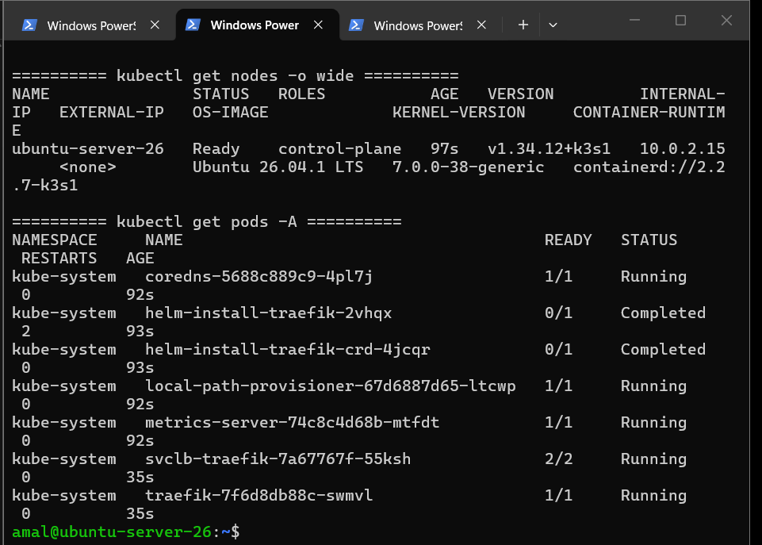
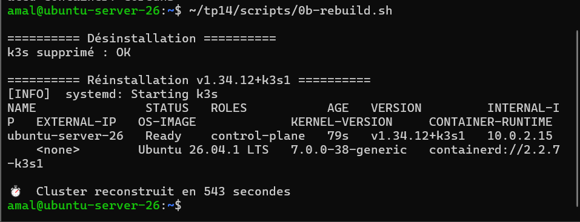
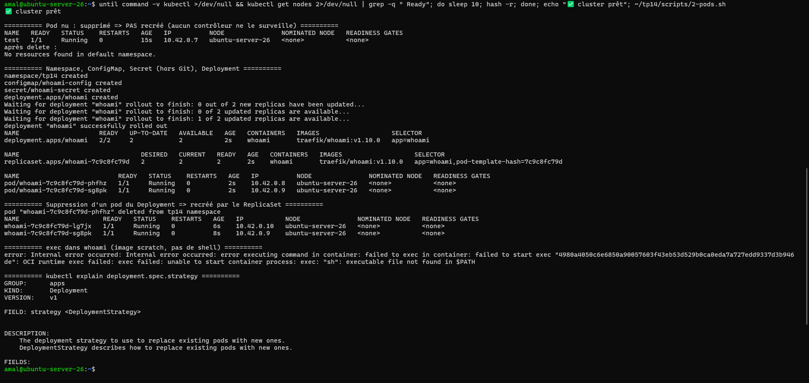
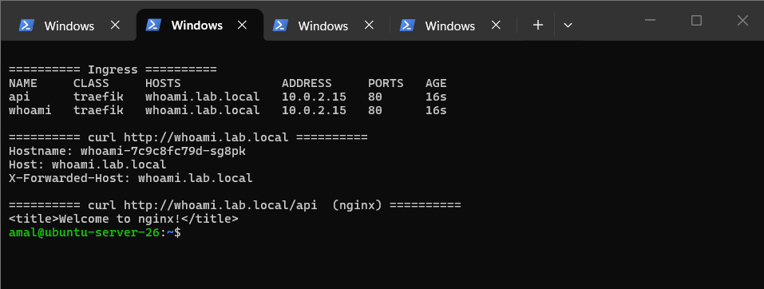
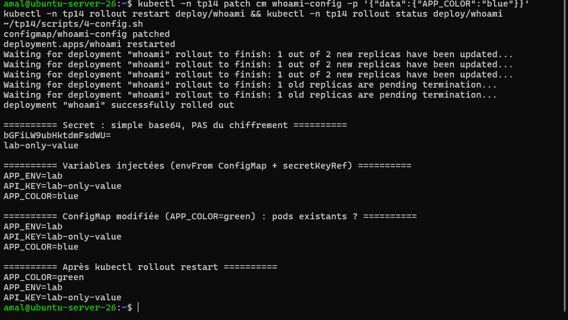
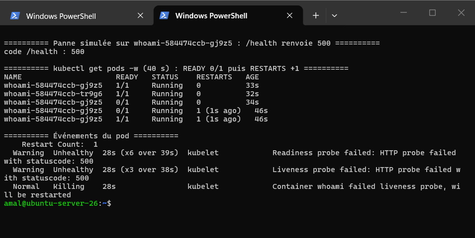
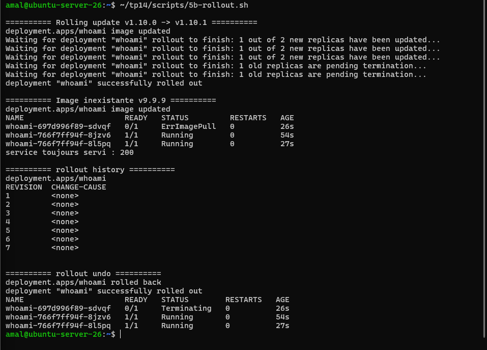
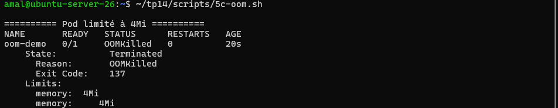
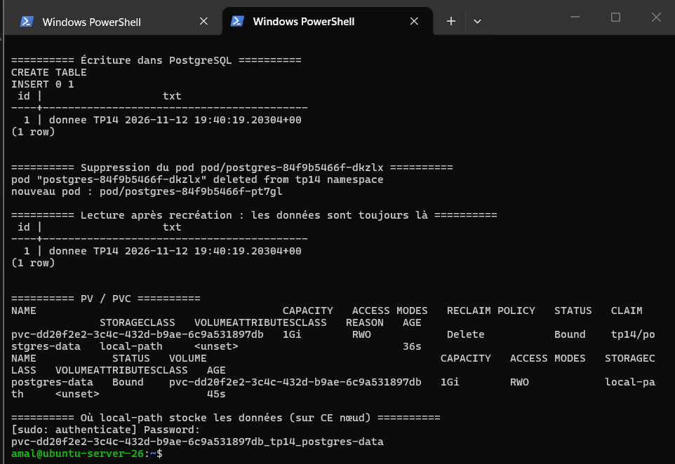
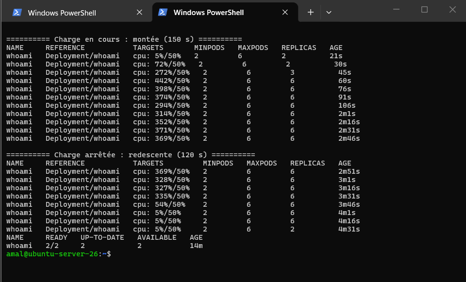

# TP14 – Kubernetes avec K3s

> **Cours** : DevOps & Cloud (Teknolabs), Partie 5 : Cloud & Kubernetes
> **Étudiante** : Amal Jemli, Master DevOps
> **Objectif** : monter un cluster Kubernetes léger (K3s) et manipuler les objets de base : Pods, Deployments, Services, Ingress, ConfigMap et Secret, sondes de santé, mises à jour progressives et rollback, stockage persistant et autoscaling.

---

## Sommaire

1. [Environnement et choix du plan B](#1-environnement-et-choix-du-plan-b)
2. [Partie 1 : cluster K3s](#2-partie-1--cluster-k3s)
3. [Partie 2 : Pods et Deployments](#3-partie-2--pods-et-deployments)
4. [Partie 3 : Services et Ingress](#4-partie-3--services-et-ingress)
5. [Partie 4 : ConfigMap et Secret](#5-partie-4--configmap-et-secret)
6. [Partie 5 : santé, ressources et déploiements progressifs](#6-partie-5--santé-ressources-et-déploiements-progressifs)
7. [Partie 6 : stockage persistant](#7-partie-6--stockage-persistant)
8. [Partie 7 : HorizontalPodAutoscaler](#8-partie-7--horizontalpodautoscaler)
9. [Challenge](#9-challenge)
10. [Difficultés rencontrées](#10-difficultés-rencontrées)
11. [Sécurité](#11-sécurité)
12. [Livrables](#12-livrables)

---

## 1. Environnement et choix du plan B

| Élément | Valeur |
|---|---|
| VM de lab | `ubuntu-server-26`, Ubuntu 26.04.1 LTS, noyau 7.0, **5,3 Go de RAM** |
| Distribution Kubernetes | **K3s v1.34.12+k3s1** (version figée) |
| Runtime | containerd 2.2.7-k3s1 |
| Composants fournis par K3s | CoreDNS, Traefik (Ingress), ServiceLB, local-path-provisioner, metrics-server |

Le TP prévoit un cluster **2 nœuds** (server + agent) créé avec Vagrant et Ansible, ce qui demande au moins 8 Go de RAM et la virtualisation imbriquée. Ma VM de lab n'a que 5,3 Go : j'ai donc appliqué le **plan B prévu par le TP**, K3s **mono-nœud installé directement sur la VM de lab**. Le TP précise que les parties 2 à 7 fonctionnent à l'identique sur un nœud unique.

Le `Vagrantfile` et le **rôle Ansible `k3s`** sont tout de même complétés et livrés dans `k3s-lab/`, prêts pour une machine plus puissante.

---

## 2. Partie 1 : cluster K3s

### 2.1 Installation (plan B)

Script : `scripts/0-k3s.sh`

```bash
curl -sfL https://get.k3s.io | INSTALL_K3S_VERSION=v1.34.12+k3s1 \
  sh -s - server --write-kubeconfig-mode 600
mkdir -p ~/.kube && sudo cat /etc/rancher/k3s/k3s.yaml > ~/.kube/config && chmod 600 ~/.kube/config
echo "127.0.0.1 whoami.lab.local" | sudo tee -a /etc/hosts
```

- La **version est figée** (`INSTALL_K3S_VERSION`) : le cluster est reproductible.
- L'installateur **vérifie l'empreinte SHA256** du binaire téléchargé.
- Le kubeconfig est en mode **600** au lieu du `644` proposé par le TP : ce fichier donne un accès **administrateur** complet au cluster.



Le nœud `ubuntu-server-26` est `Ready` avec le rôle `control-plane`, et tous les composants système tournent.

### 2.2 Version Vagrant + Ansible (livrée, non exécutée)

`k3s-lab/Vagrantfile` : la table `NODES` décrit les VM. Ansible ne s'exécute qu'**une fois, après la dernière VM**, sur toutes les machines (`limit = "all"`).

Le playbook est converti en **rôle** `roles/k3s` :

```
k3s-lab/
├── Vagrantfile
├── playbook.yml
└── roles/k3s/
    ├── defaults/main.yml     # k3s_version: v1.34.12+k3s1, IP du server
    └── tasks/
        ├── main.yml          # include server.yml ou agent.yml
        ├── server.yml
        └── agent.yml
```

TODO complétés dans `server.yml` :

```yaml
- name: Installer le server K3s (idempotent)
  ansible.builtin.shell: >
    curl -sfL https://get.k3s.io | INSTALL_K3S_VERSION={{ k3s_version }}
    sh -s - server --node-ip {{ node_ip }} --tls-san {{ k3s_server_ip }}
    --write-kubeconfig-mode 644
  args:
    creates: /usr/local/bin/k3s          # idempotence : rien si déjà installé

- name: Lire le token du server
  ansible.builtin.slurp:
    src: /var/lib/rancher/k3s/server/node-token
  register: k3s_token_raw
  no_log: true                           # le token n'apparaît jamais dans les logs
```

L'agent rejoint le cluster avec `K3S_URL=https://192.168.56.10:6443` et `K3S_TOKEN`. Le kubeconfig est récupéré avec `fetch`, puis `127.0.0.1` est remplacé par l'IP du server.

### 2.3 Reconstruction complète

Script : `scripts/0b-rebuild.sh`. C'est l'équivalent plan B de `vagrant destroy -f && vagrant up` : désinstallation totale (`k3s-uninstall.sh`), puis réinstallation de la même version.



Résultat : **cluster reconstruit en 543 secondes (environ 9 min)**, avec le nœud `Ready` et la même version `v1.34.12+k3s1`. L'**infrastructure est jetable** : on peut la recréer à l'identique en une commande. La quasi-totalité du temps est passée à **télécharger le binaire K3s** (environ 70 Mo, connexion lente). Avec un miroir local ou une installation air-gap, la reconstruction prendrait moins d'une minute.

### 2.4 Composants du plan de contrôle

| Composant | Rôle | Dans K3s |
|---|---|---|
| API server | point d'entrée unique (kubectl, contrôleurs) | intégré au binaire `k3s` |
| Datastore | état du cluster | **SQLite** par défaut (etcd pour la haute disponibilité) |
| Scheduler | choisit le nœud de chaque pod | intégré |
| Controller manager | boucles de réconciliation (ReplicaSet, etc.) | intégré |
| kubelet | lance les conteneurs sur le nœud | intégré, utilise **containerd** |

---

## 3. Partie 2 : Pods et Deployments

Script : `scripts/2-pods.sh`

| Test | Résultat | Explication |
|---|---|---|
| Pod nu `kubectl run test`, puis `delete` | **pas recréé** | aucun contrôleur ne le surveille |
| Pod d'un Deployment supprimé | **recréé immédiatement** | le ReplicaSet réconcilie : état voulu = 2 réplicas |
| `kubectl exec -it deploy/whoami -- sh` | **échec** | l'image whoami est construite `FROM scratch` : aucun shell. Surface d'attaque minimale |



Résultats observés :
- pod nu `test` supprimé : `No resources found in default namespace`, il n'est **pas recréé** ;
- `whoami-...-phfhz` supprimé : remplacé en quelques secondes par `whoami-...-lg7jx`, et le Deployment reste à **2/2** ;
- `exec ... sh` : `exec: "sh": executable file not found in $PATH`, il n'y a **pas de shell** dans l'image, ce qui était prévu ;
- tous les pods tournent sur le seul nœud `ubuntu-server-26` (plan B mono-nœud), avec des IP du réseau de pods `10.42.0.0/16` (flannel).

---

## 4. Partie 3 : Services et Ingress

Script : `scripts/3-svc-ingress.sh`

TODO complété dans `04-service.yaml` : le sélecteur `app: whoami` doit correspondre aux labels du template du Deployment. Sinon, le Service n'a **aucun endpoint**.

- `port-forward` : les requêtes successives tombent sur **des pods différents** (répartition de charge du Service).
- DNS interne : `http://whoami.tp14.svc.cluster.local` résolu depuis un pod busybox temporaire.
- TODO complété dans `05-ingress.yaml` : un Deployment et un Service **nginx** servis sous **`/api`**. Un `Middleware` Traefik `stripPrefix` retire `/api` avant d'arriver à nginx.



- `whoami.lab.local/` arrive sur un pod whoami. Traefik ajoute `X-Forwarded-Host`, ce qui prouve que la requête est passée par l'Ingress.
- `whoami.lab.local/api` arrive sur **nginx** (`Welcome to nginx!`) grâce au second Ingress et au middleware `stripPrefix`.
- Les deux Ingress ont l'adresse `10.0.2.15` (IP du nœud), exposée sur le port 80 par le ServiceLB de K3s.

| Type de Service | Exposition |
|---|---|
| ClusterIP (défaut) | interne au cluster uniquement |
| NodePort | port 30000-32767 ouvert sur chaque nœud |
| LoadBalancer | IP externe (ServiceLB sur K3s, load balancer du cloud ailleurs) |
| Ingress | routage HTTP par **nom d'hôte et chemin**, un seul point d'entrée |

---

## 5. Partie 4 : ConfigMap et Secret

Script : `scripts/4-config.sh`

- La ConfigMap `whoami-config` est injectée avec `envFrom`, et la clé du Secret avec `secretKeyRef` (variable `API_KEY`).
- Le **Secret est créé en ligne de commande**, il n'est **jamais versionné** :
  ```bash
  kubectl -n tp14 create secret generic whoami-secret --from-literal=api-key='lab-only-value'
  ```
- Démonstration : `kubectl get secret -o yaml` affiche la valeur en **base64**, et `base64 -d` la décode immédiatement. **Le base64 est un encodage, pas un chiffrement.**
- Après modification de la ConfigMap (`APP_COLOR` blue → green), les pods existants **gardent l'ancienne valeur** : les variables d'environnement sont lues au démarrage du conteneur. Il faut un **`kubectl rollout restart`** pour la prendre en compte.



Lecture du résultat :
- `bGFiLW9ubHktdmFsdWU=` se décode instantanément en `lab-only-value` : **n'importe qui pouvant lire le Secret obtient la valeur** ;
- `APP_COLOR=blue` **reste blue** après le `patch` de la ConfigMap ;
- il passe à **green** seulement après `kubectl rollout restart`, qui recrée les pods.

> Pour une prise en compte automatique, on peut monter la ConfigMap **en volume** (fichiers mis à jour par le kubelet en environ 1 min), ou ajouter dans le template un **hash de la ConfigMap en annotation**, ce que fait Helm (TP15), pour déclencher un rollout à chaque changement.

---

## 6. Partie 5 : santé, ressources et déploiements progressifs

### 6.1 Sondes

```yaml
readinessProbe:            # « prêt à recevoir du trafic ? »
  httpGet: { path: /health, port: http }
  periodSeconds: 3
livenessProbe:             # « encore vivant ? », sinon redémarrage
  httpGet: { path: /health, port: http }
  periodSeconds: 5
  failureThreshold: 3
resources:
  requests: { cpu: 20m, memory: 16Mi }
  limits:   { cpu: 100m, memory: 64Mi }
```

Panne simulée : `POST /health` avec `500`. Le pod passe `READY 0/1` (**retiré des endpoints** par la readinessProbe), puis il est **redémarré** par la livenessProbe (RESTARTS +1).



Chronologie observée sur `whoami-584474ccb-gj9z5` :
1. la **readinessProbe** échoue (`Readiness probe failed ... statuscode: 500`, 6 fois) : le pod passe `0/1` et **sort des endpoints**, donc plus de trafic. L'autre pod continue de servir ;
2. la **livenessProbe** échoue 3 fois (`failureThreshold: 3`) : `Killing ... failed liveness probe, will be restarted` ;
3. le conteneur redémarre (**RESTARTS 1**), `/health` revient à 200, et le pod repasse `1/1`.

> Le pod n'est pas recréé, seul son **conteneur** redémarre : même nom de pod, `Restart Count: 1`.

### 6.2 Rolling update et rollback

`v1.10.0` → `v1.10.1` sans interruption, puis une image inexistante `v9.9.9` : le nouveau pod reste en `ImagePullBackOff`, **les anciens pods continuent de servir**, et `rollout undo` revient à la version précédente.



- Avec l'image `v9.9.9`, le nouveau pod reste en `ErrImagePull` (`0/1`), tandis que les **2 anciens pods restent `Running`** : `service toujours servi : 200`.
- `rollout history` liste 7 révisions, à cause des `rollout restart` et des `set image` précédents. La colonne `CHANGE-CAUSE` est vide : en équipe, on la remplit avec l'annotation `kubernetes.io/change-cause`.
- `rollout undo` : le pod fautif passe en `Terminating`, et on revient à la révision précédente.

**Pourquoi le service n'a jamais été interrompu :**
- `maxUnavailable: 0` : Kubernetes ne supprime jamais un ancien pod avant qu'un nouveau soit prêt ;
- `maxSurge: 1` : il crée un pod en plus pendant la mise à jour ;
- la **readinessProbe** : un nouveau pod ne reçoit du trafic qu'une fois `/health` OK. Un pod qui ne démarre pas, comme avec l'image inexistante, ne reçoit donc jamais de requêtes.

### 6.3 OOMKilled

Script : `scripts/5c-oom.sh`. Un pod limité à `4Mi` qui tente d'allouer 32 Mo est tué par le noyau : `Reason: OOMKilled`, `Exit Code: 137`. La limite mémoire est **dure** : elle protège le nœud contre un conteneur qui consommerait toute la RAM.



---

## 7. Partie 6 : stockage persistant

Script : `scripts/6-pvc.sh`. TODO complété dans `06-postgres.yaml` : le PVC `postgres-data` est monté sur `/var/lib/postgresql/data`, avec la stratégie `Recreate`, nécessaire pour un volume `ReadWriteOnce`.

Le mot de passe PostgreSQL est **généré aléatoirement** (`openssl rand -hex 16`) directement dans le Secret. Il n'est jamais affiché ni écrit dans un fichier.



La ligne `donnee TP14 2026-11-12 19:40:19` est **toujours présente** après la suppression du pod `postgres-...-dkzlx` et son remplacement par `postgres-...-pt7gl`. Le PV `pvc-dd20f2e2-...` (1Gi, RWO, `local-path`, politique `Delete`) est `Bound` au PVC `tp14/postgres-data`.

> Politique `Delete` : si le PVC est supprimé, le volume et ses **données sont détruits**. Pour une base de production, on choisit `Retain`.

**Limite de `local-path`** : les données sont stockées **sur le disque du nœud**, dans le dossier `/var/lib/rancher/k3s/storage/pvc-dd20f2e2-..._tp14_postgres-data`. Si le pod est replanifié sur **un autre nœud**, il ne retrouve pas ses données. Pour un cluster multi-nœuds en production, il faut un stockage réseau ou répliqué (Longhorn, Ceph, EBS…).

---

## 8. Partie 7 : HorizontalPodAutoscaler

Script : `scripts/7-hpa.sh`. HPA `autoscaling/v2` de 2 à 6 réplicas, avec une cible CPU de **50 % des `requests`** (20m). Deux pods busybox génèrent la charge.



Déroulé observé :
- **montée** : le CPU passe de 5 % à 72 %, puis à **442 %** de la cible. Les réplicas passent de **2 à 3, puis à 6**, le maximum (`maxReplicas`), en environ 1 minute ;
- tant que la charge continue, l'HPA reste à 6 réplicas avec un CPU autour de 300-370 %, plafonné par `maxReplicas` ;
- **redescente** : après l'arrêt de la charge, le CPU retombe à 5 % et les réplicas reviennent à **2** (`minReplicas`), et le Deployment est à `2/2`.

La fenêtre de stabilisation a été réduite à 30 s pour la démo (300 s par défaut), ce qui évite le « yo-yo » des réplicas en production.

> Sans `resources.requests.cpu`, l'HPA ne peut pas calculer de pourcentage : les requests sont **obligatoires**.

---

## 9. Challenge

1. **3ᵉ nœud** : il suffit de décommenter la ligne `k3s-agent2` dans la table `NODES` du `Vagrantfile`. Non exécuté, faute de RAM.
2. **PodDisruptionBudget** `minAvailable: 1` (`k8s-starter/08-pdb.yaml`) : un `kubectl drain` qui supprimerait tous les pods whoami est **bloqué** tant qu'un pod ne tourne pas ailleurs.

---

## 10. Difficultés rencontrées

| Problème | Cause | Solution |
|---|---|---|
| RAM insuffisante pour 2 VM imbriquées (5,3 Go) | 8 Go requis | **plan B** du TP : K3s mono-nœud sur la VM de lab |
| Téléchargement du binaire K3s très lent | connexion lente | patience. Un 1ᵉʳ essai arrêté a laissé un dossier `/tmp/k3s-install.*`, supprimé ensuite |
| coredns `ErrImagePull`, `helm-install-traefik` en `CrashLoopBackOff` | échecs DNS temporaires de la VM (`lookup registry-1.docker.io: Try again`) | **réconciliation automatique** : Kubernetes a réessayé seul, et tout est passé `Running` en 1 min 30 |
| `kubectl: command not found` | `0b-rebuild.sh` lancé dans un autre onglet avait désinstallé K3s (et son lien `kubectl`) | attendre la fin de la reconstruction, puis `hash -r` |
| Résultats mélangés (APP_COLOR déjà green, nouveau ReplicaSet pendant le test des sondes) | scripts lancés en parallèle dans plusieurs onglets | réinitialisation de la ConfigMap, puis un seul script à la fois dans un seul onglet |
| `Permission denied` sur les scripts | droit d'exécution perdu lors de la copie depuis Windows | `chmod +x ~/tp14/scripts/*.sh` |

---

## 11. Sécurité

- **Kubeconfig = accès administrateur** : mode `600`, **jamais commité** (`k3s.yaml` et `kubeconfig*` dans `.gitignore`).
- **Aucun Secret dans Git** : `whoami-secret` et `postgres-secret` sont créés en ligne de commande. Le mot de passe PostgreSQL est aléatoire et jamais affiché.
- **Base64 ≠ chiffrement** : en production, on active le chiffrement au repos (`k3s secrets-encrypt`) et on utilise un gestionnaire externe (Vault, External Secrets, Sealed Secrets).
- Namespace en **Pod Security Admission `baseline`** : les pods privilégiés sont refusés.
- whoami durci : `runAsNonRoot`, `readOnlyRootFilesystem`, `allowPrivilegeEscalation: false`, `capabilities: drop ALL`, `seccompProfile: RuntimeDefault`, `automountServiceAccountToken: false`.
- **requests et limits** sur tous les conteneurs : un pod ne peut pas saturer le nœud (démontré avec OOMKilled).
- Images en **versions figées** (`whoami:v1.10.0`, `busybox:1.37`, `postgres:17-alpine`), jamais `latest`.
- Token d'agent K3s lu avec `no_log: true` dans Ansible.

---

## 12. Livrables

| Livrable | Fichier |
|---|---|
| Cluster | `captures/cluster-nodes.png` |
| Reconstruction | `captures/rebuild.png` |
| Ingress `/` et `/api` | `captures/ingress.png` |
| Redémarrage par la livenessProbe | `captures/probes-restart.png` |
| Rollback | `captures/rollout-undo.png` |
| Persistance PostgreSQL | `captures/pvc-persistence.png` |
| Autoscaling | `captures/hpa.png` |
| Vagrantfile + rôle Ansible `k3s` | `k3s-lab/` |
| Manifests complétés | `k8s-starter/01` à `08` |
| Scripts | `scripts/` |
