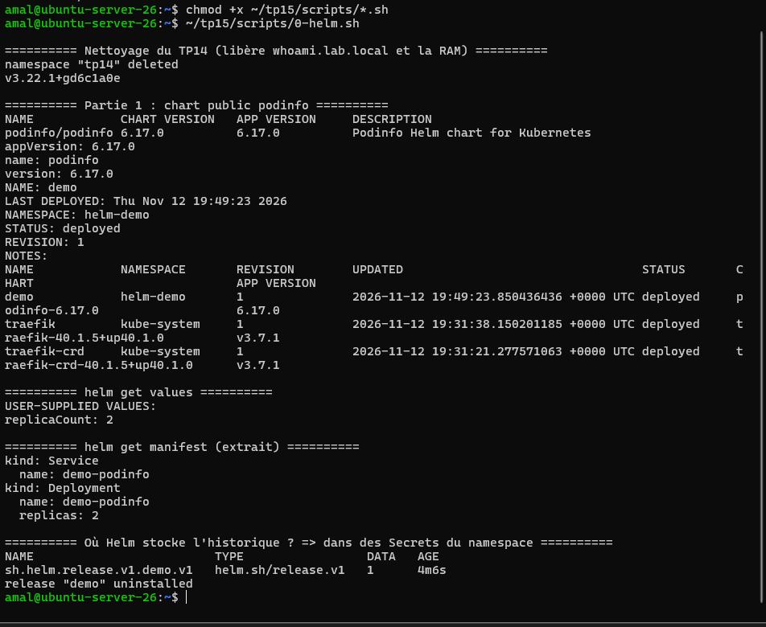
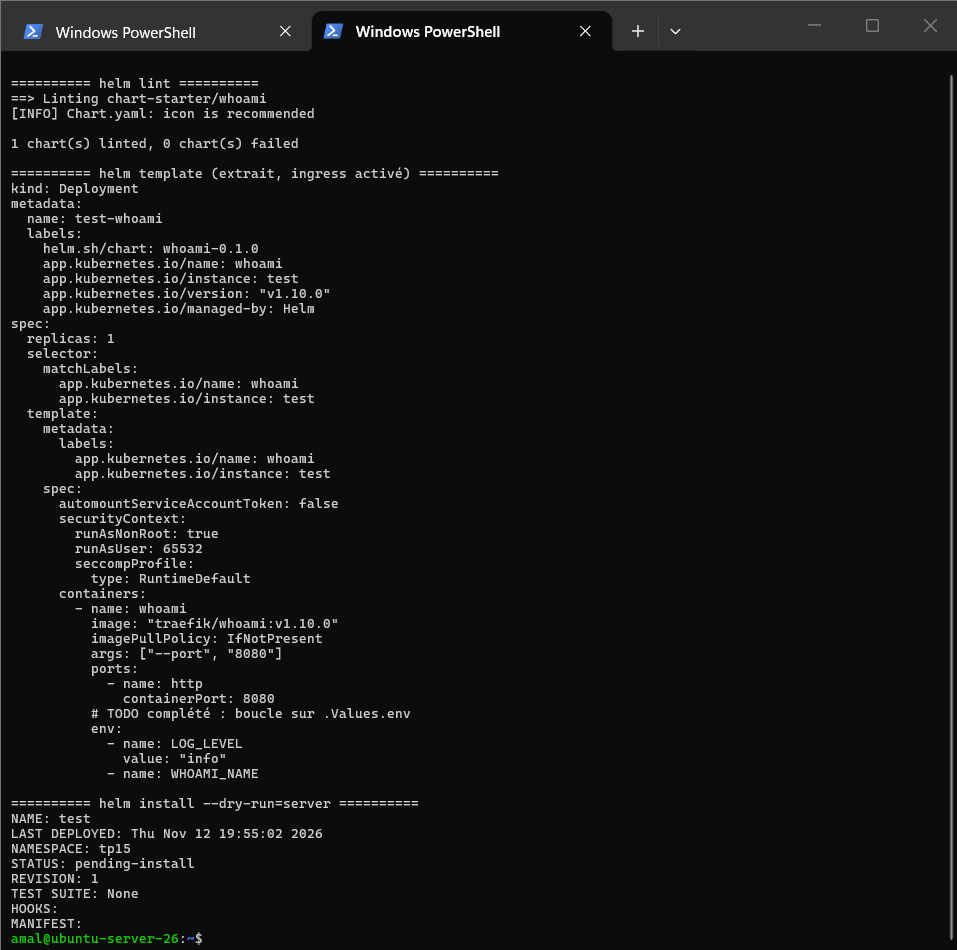
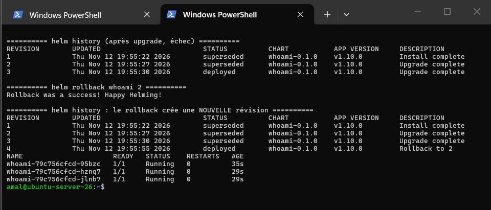
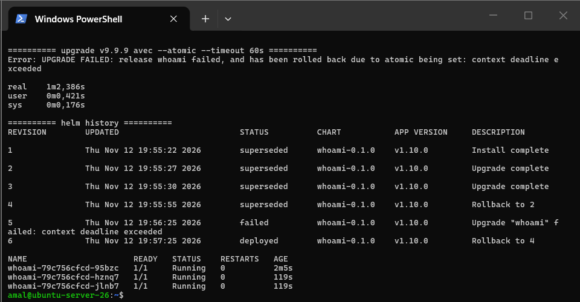
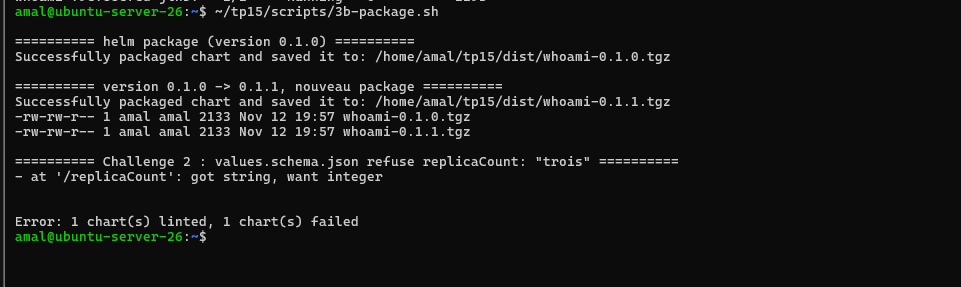
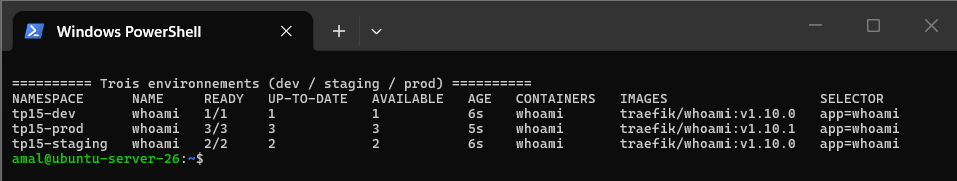
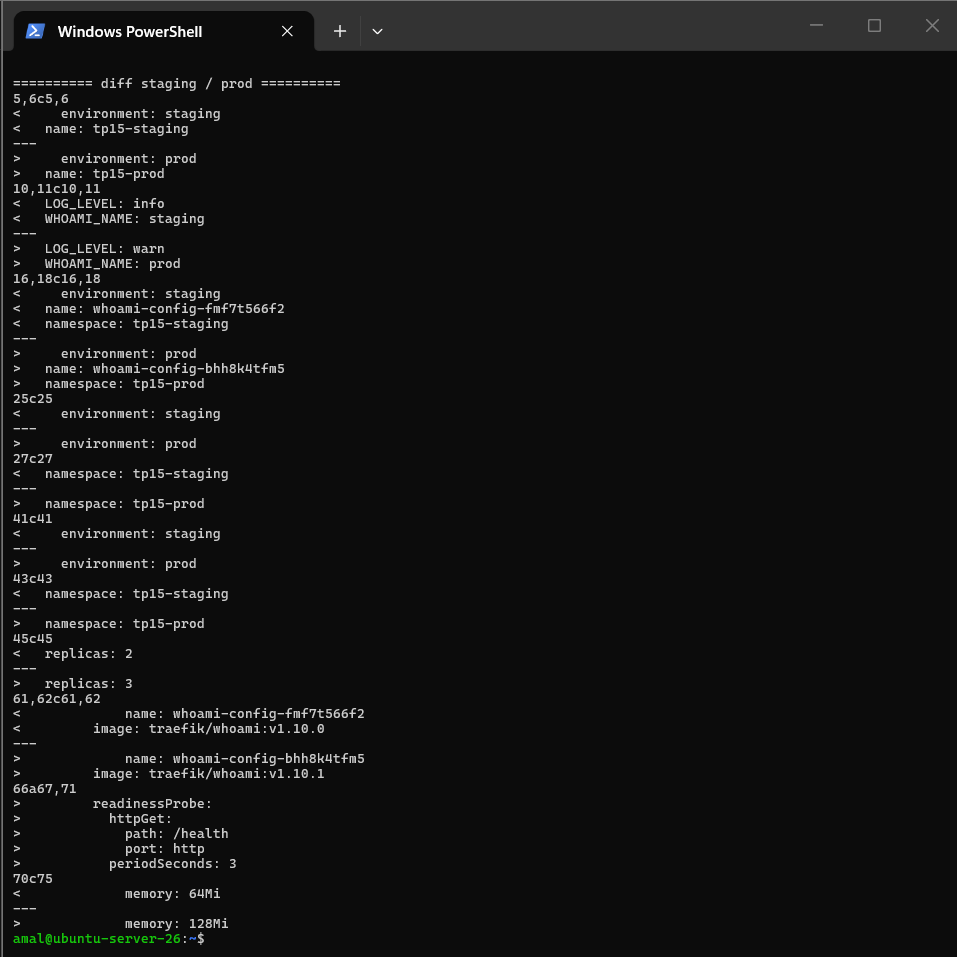
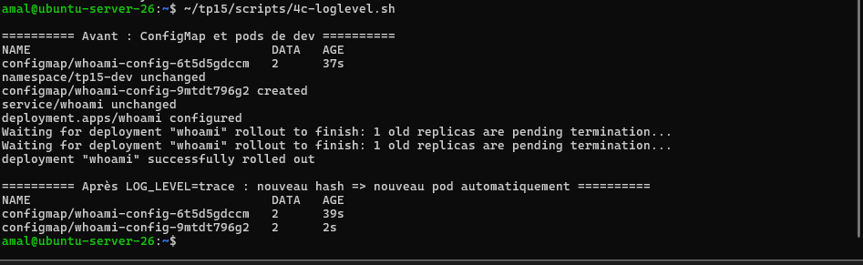

# TP15 – Packager une application Kubernetes avec Helm et Kustomize

> **Cours** : DevOps & Cloud (Teknolabs), Partie 5 : Cloud & Kubernetes
> **Étudiante** : Amal Jemli, Master DevOps
> **Objectif** : construire **la même application deux fois**, d'abord comme **chart Helm** (templates + values, releases versionnées), puis comme **base Kustomize avec overlays** (patches, sans templates), et comparer les deux approches.

---

## Sommaire

1. [Environnement](#1-environnement)
2. [Partie 1 : consommer un chart public](#2-partie-1--consommer-un-chart-public)
3. [Partie 2 : écrire son propre chart](#3-partie-2--écrire-son-propre-chart)
4. [Partie 3 : cycle de vie d'une release](#4-partie-3--cycle-de-vie-dune-release)
5. [Partie 4 : Kustomize, base et overlays](#5-partie-4--kustomize-base-et-overlays)
6. [Partie 5 : comparaison Helm / Kustomize](#6-partie-5--comparaison-helm--kustomize)
7. [Challenge](#7-challenge)
8. [Nettoyage](#8-nettoyage)
9. [Sécurité](#9-sécurité)
10. [Livrables](#10-livrables)

---

## 1. Environnement

| Élément | Valeur |
|---|---|
| Cluster | K3s v1.34.12+k3s1 du TP14 (mono-nœud `ubuntu-server-26`) |
| Helm | **v3.22.1**, installé avec le script officiel `get-helm-3` (empreinte SHA256 vérifiée) |
| Kustomize | intégré à `kubectl` (`kubectl kustomize`, `kubectl apply -k`) |
| Ingress | Traefik (fourni par K3s), `whoami.lab.local` → 127.0.0.1 |

Le namespace `tp14` est supprimé au début (`scripts/0-helm.sh`) pour libérer l'hôte `whoami.lab.local` et la RAM.

---

## 2. Partie 1 : consommer un chart public

Script : `scripts/0-helm.sh`

```bash
helm repo add podinfo https://stefanprodan.github.io/podinfo && helm repo update
helm show chart podinfo/podinfo                 # on inspecte AVANT d'installer
helm install demo podinfo/podinfo -n helm-demo --create-namespace --set replicaCount=2
helm get values demo -n helm-demo               # USER-SUPPLIED VALUES: replicaCount: 2
helm get manifest demo -n helm-demo
```



**Où Helm stocke-t-il l'historique des releases ?** Dans des **Secrets Kubernetes** du namespace de la release, de type `helm.sh/release.v1` : ici `sh.helm.release.v1.demo.v1`, un par révision. Il n'y a ni serveur ni base de données : depuis Helm 3, tout est dans le cluster.

> `helm list -A` montre aussi que **Traefik est lui-même installé par Helm** dans K3s (releases `traefik` et `traefik-crd` dans `kube-system`).

---

## 3. Partie 2 : écrire son propre chart

```
chart-starter/
├── values-dev.yaml
├── values-prod.yaml
└── whoami/
    ├── Chart.yaml            # version: 0.1.0 / appVersion: "v1.10.0"
    ├── values.yaml
    ├── values.schema.json    # challenge 2
    └── templates/
        ├── _helpers.tpl      # name, fullname, labels, selectorLabels
        ├── deployment.yaml
        ├── service.yaml
        └── ingress.yaml
```

**`version` ou `appVersion` :**
- `version` est la version du **chart**, c'est-à-dire du packaging. On l'incrémente à chaque modification des templates ou des values, et elle donne le nom de l'archive (`whoami-0.1.0.tgz`).
- `appVersion` est la version de l'**application** livrée. Ici, elle sert de **tag d'image par défaut** : `{{ .Values.image.tag | default .Chart.AppVersion }}`.

**TODO complétés :**

```yaml
# deployment.yaml : boucle range sur .Values.env
env:
  {{- range $key, $value := .Values.env }}
  - name: {{ $key }}
    value: {{ $value | quote }}
  {{- end }}
readinessProbe:
  httpGet: { path: {{ .Values.probes.path }}, port: http }
livenessProbe:
  httpGet: { path: {{ .Values.probes.path }}, port: http }
```

```yaml
# ingress.yaml : rendu uniquement si ingress.enabled
{{- if .Values.ingress.enabled }}
apiVersion: networking.k8s.io/v1
kind: Ingress
...
    - host: {{ required "ingress.host est obligatoire quand l'ingress est activé" .Values.ingress.host | quote }}
{{- end }}
```

Le `service.yaml` est entièrement paramétré : `type`, `port` et sélecteur via `include "whoami.selectorLabels"`.

| Fonction | Utilisation dans le chart |
|---|---|
| `include` + `nindent` | labels et selectorLabels insérés avec la bonne indentation |
| `default` | tag d'image → `.Chart.AppVersion` si vide |
| `toYaml` | blocs `resources`, `securityContext` et `podSecurityContext` copiés tels quels |
| `quote` | `"8080"` dans `args`, valeurs des variables d'environnement |
| `required` | `replicaCount` et `ingress.host` obligatoires |

**Validation :**

```bash
helm lint chart-starter/whoami
helm template test chart-starter/whoami --set ingress.enabled=true
helm install test chart-starter/whoami --dry-run=server -n tp15 --create-namespace
```



Résultat : `1 chart(s) linted, 0 chart(s) failed`. Le seul message est un `[INFO]` qui recommande une icône. Le `--dry-run=server` fait valider les manifests par l'API du cluster, sans rien créer.

---

## 4. Partie 3 : cycle de vie d'une release

| Fichier | Contenu |
|---|---|
| `values-dev.yaml` | 1 réplica, Ingress activé, `WHOAMI_NAME: dev`, `LOG_LEVEL: debug` |
| `values-prod.yaml` | 3 réplicas, Ingress désactivé, limites relevées (`250m` / `128Mi`) |

Script : `scripts/2-lifecycle.sh` (install → upgrade 3 réplicas → upgrade vers une image inexistante → rollback)



**Analyse :**
- La révision 3 (image `v9.9.9`) apparaît comme **`deployed` / `Upgrade complete`**, alors que les pods étaient en `ImagePullBackOff`. Sans `--wait`, Helm considère l'upgrade réussi dès que l'API **accepte** les manifests, sans vérifier que les pods démarrent.
- `helm rollback whoami 2` **crée une nouvelle révision 4** (`Rollback to 2`) au lieu de revenir en arrière dans l'historique. L'historique est **en ajout seul**, donc traçable.

### `--atomic`

Script : `scripts/3-atomic.sh`

```bash
helm upgrade whoami chart-starter/whoami -n tp15 -f values-dev.yaml \
  --set image.tag=v9.9.9 --atomic --timeout 60s
```



Helm **attend** que les pods soient prêts. Au bout de 60 s (`real 1m2s`), il marque la révision 5 **`failed`** et crée **automatiquement** la révision 6 `Rollback to 4`. Les 3 pods en service n'ont jamais été remplacés. **C'est le mode à utiliser en CI/CD** : un déploiement raté ne laisse jamais le cluster dans un état cassé.

### `helm package`

```
whoami-0.1.0.tgz   (version: 0.1.0)
whoami-0.1.1.tgz   (après passage de version à 0.1.1)
```

Le nom de l'archive est `<name>-<version>.tgz` : il dépend de **`version`**, pas de `appVersion`.



---

## 5. Partie 4 : Kustomize, base et overlays

```
kustomize-starter/
├── base/
│   ├── deployment.yaml
│   ├── service.yaml
│   └── kustomization.yaml       # configMapGenerator + label part-of=tp15
└── overlays/
    ├── dev/       # 1 réplica, WHOAMI_NAME=dev, LOG_LEVEL=debug
    ├── staging/   # 2 réplicas, WHOAMI_NAME=staging
    └── prod/      # 3 réplicas, image v1.10.1, limits 128Mi, readinessProbe
        ├── kustomization.yaml
        └── readiness-patch.yaml
```

Overlay **prod** :

```yaml
namespace: tp15-prod
replicas:
  - name: whoami
    count: 3
images:                          # tag changé sans toucher au YAML de base
  - name: traefik/whoami
    newTag: v1.10.1
configMapGenerator:
  - name: whoami-config
    behavior: merge
    literals: [WHOAMI_NAME=prod, LOG_LEVEL=warn]
patches:
  - target: { kind: Deployment, name: whoami }   # patch JSON 6902
    patch: |-
      - op: replace
        path: /spec/template/spec/containers/0/resources/limits/memory
        value: 128Mi
  - path: readiness-patch.yaml                   # patch stratégique (fichier)
```



Les trois environnements tournent en même temps, chacun dans son namespace : **dev 1/1, staging 2/2, prod 3/3**, avec prod sur l'image `v1.10.1`.

### Différences staging / prod



Le `diff` ne montre **que** ce que l'overlay change : namespace, label `environment`, `LOG_LEVEL` et `WHOAMI_NAME`, **nom de la ConfigMap avec un hash différent**, `replicas`, tag d'image, `readinessProbe` ajoutée et `memory: 128Mi`. Le YAML final reste lisible et vérifiable avant d'être appliqué.

### Changement de `LOG_LEVEL` : pourquoi les pods redémarrent seuls



Le `configMapGenerator` ajoute au nom de la ConfigMap un **suffixe calculé à partir de son contenu** (`whoami-config-6t5d5gdccm` devient `whoami-config-9mtdt796g2`). Le Deployment référence ce nouveau nom, donc **son template change**, et Kubernetes lance automatiquement un **rolling update** (`deployment.apps/whoami configured`).

Au **TP14**, la ConfigMap avait un nom fixe : sa modification ne touchait pas le Deployment, et il avait fallu un `kubectl rollout restart` manuel.

> L'ancienne ConfigMap reste en place, ce qui permet un rollback. On la nettoie avec `kubectl apply -k --prune` ou via Argo CD.

---

## 6. Partie 5 : comparaison Helm / Kustomize

| Critère | Helm | Kustomize |
|---|---|---|
| Mécanisme | **templates** Go + values | **patches** sur du YAML valide, sans template |
| Gestion des releases et rollback | ✅ releases versionnées, `history`, `rollback`, `--atomic` | ❌ pas de notion de release : rollback via Git (ou Argo CD) |
| Distribution à des tiers | ✅ chart packagé (`.tgz`), dépôts HTTP ou **OCI**, values documentées | ⚠️ partage d'une base via Git, moins adapté au grand public |
| Lisibilité du YAML final | ⚠️ templates difficiles à lire, il faut `helm template` | ✅ base en YAML pur, `kubectl kustomize` montre le résultat |
| Intégré à `kubectl` | ❌ binaire séparé | ✅ `kubectl apply -k` |
| Support Argo CD | ✅ natif | ✅ natif |

**Quand les utiliser ensemble ?**
- Pour **personnaliser un chart tiers** sans le forker : un `kustomization.yaml` avec `helmCharts:` rend le chart, puis on applique nos propres patches (labels de l'entreprise, sidecar, `securityContext`…).
- En pratique : **Helm pour installer des logiciels tiers** (Traefik, podinfo, ingress, monitoring), et **Kustomize pour nos propres applications** et leurs différences entre environnements.

---

## 7. Challenge

1. **Chart poussé dans un registre OCI (Harbor)** : **non réalisé**. La VM Harbor du TP12 est arrêtée, faute de RAM pour la faire tourner en même temps que K3s. Les commandes prévues :
   ```bash
   helm registry login harbor.lab.local          # mot de passe saisi, jamais en argument
   helm push whoami-0.1.0.tgz oci://harbor.lab.local/devsecops
   helm install whoami oci://harbor.lab.local/devsecops/whoami --version 0.1.0 -n tp15
   ```
2. **`values.schema.json`** ✅ : `helm lint --set replicaCount=trois` est refusé avec `at '/replicaCount': got string, want integer`, et le lint échoue (voir la capture `helm-package-schema.png`). Le schéma valide aussi `pullPolicy` (énumération), `service.type` et le type des variables d'environnement.

---

## 8. Nettoyage

```bash
helm uninstall whoami -n tp15
kubectl delete ns tp15 tp15-dev tp15-staging tp15-prod
/usr/local/bin/k3s-uninstall.sh      # fin de la partie 5 : libère la VM
```

---

## 9. Sécurité

- **Inspecter un chart tiers avant de l'installer** (`helm show chart` / `helm show values`) : un chart peut créer n'importe quelle ressource, y compris des ClusterRoles.
- Helm installé avec le **script officiel**, qui vérifie l'empreinte SHA256. Version figée **v3.22.1**.
- **Les Secrets de release Helm contiennent toutes les values** : il ne faut jamais mettre de mot de passe dans `values.yaml`. On utilise des Secrets créés à part (External Secrets, Sealed Secrets).
- **`values.schema.json`** : il refuse une configuration invalide **avant** le déploiement.
- **`--atomic`** : un déploiement raté est annulé automatiquement.
- Conteneurs durcis dans les deux versions : `runAsNonRoot`, `readOnlyRootFilesystem`, `capabilities: drop ALL`, `seccompProfile`, `automountServiceAccountToken: false`, plus requests et limits.
- Images en versions figées (`v1.10.0`, `v1.10.1`), jamais `latest`.
- Pour le challenge OCI : `helm registry login` avec une saisie interactive ou `--password-stdin`, et un **compte robot Harbor** limité au push (TP12).

---

## 10. Livrables

| Livrable | Fichier |
|---|---|
| Lint + template | `captures/helm-lint-template.png` ⭐ |
| Historique et rollback | `captures/helm-history.png` ⭐ |
| `--atomic` | `captures/helm-atomic.png` ⭐ |
| 3 environnements Kustomize | `captures/kustomize-envs.png` ⭐ |
| Diff staging / prod | `captures/kustomize-diff.png` ⭐ |
| Chart OCI (challenge) | non réalisé (Harbor arrêté), commandes documentées |
| Bonus | `helm-podinfo.png`, `helm-package-schema.png`, `kustomize-loglevel.png` |
| Chart complété | `chart-starter/whoami/` + `values-dev.yaml`, `values-prod.yaml` |
| Overlays | `kustomize-starter/overlays/{dev,staging,prod}` |
| Tableau comparatif | section 6 |
